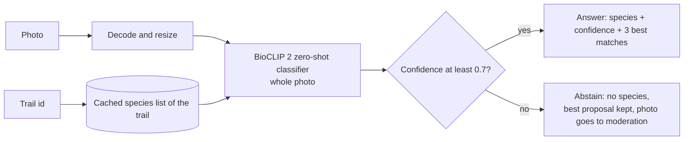
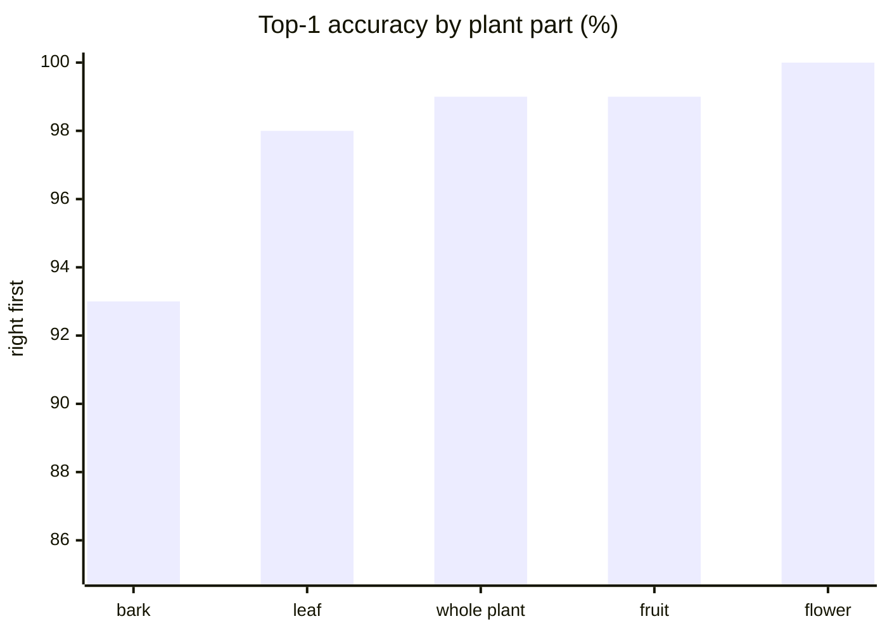
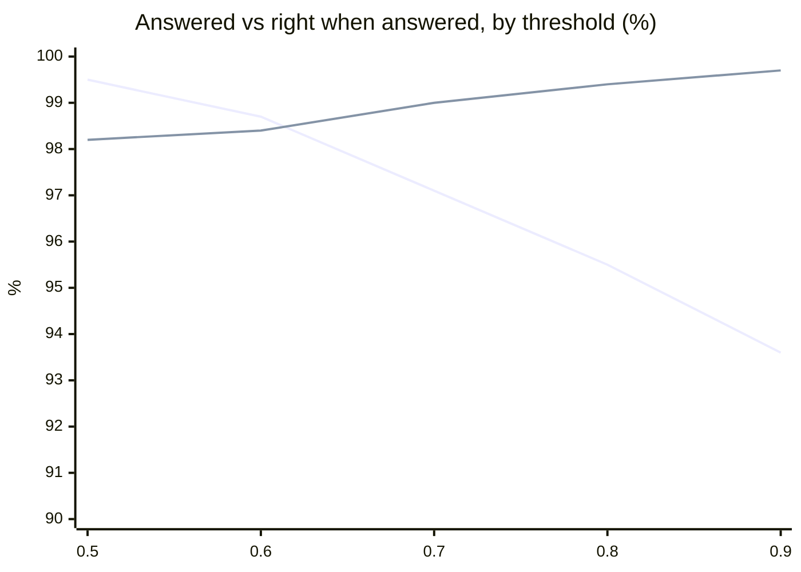

# ia Traily species identification

Python 3.11+ service that tells a hiker which plant is in a photo. It is called by
`server` (Go) over internal HTTP only, never by the mobile app directly.

Linear ticket: **TRA-41** (identify a species from a photo). The HTTP layer (TRA-50),
the NSFW check, `/recommend` (TRA-51) and the community aggregation (TRA-72) are **not
part of this repository state**.

> **Status: best result reachable without real hiker photos.** The model, the lists and
> the measurements are in place, but thresholds are provisional until we have photos
> taken on a real hike (Paimpont). See [Known limits](#known-limits).

- Working decisions: [CLAUDE.md](CLAUDE.md)
- Reasoning: [docs/adr/](docs/adr/) (ADR 0001: model choice; ADR 0002: flora-only scope)
- Quality rules: [docs/QUALITY_PLAN_AI_SERVICES.md](docs/QUALITY_PLAN_AI_SERVICES.md)
- Image and model licences: [DATASET_LICENSES.md](DATASET_LICENSES.md)

## How it works



- **One classifier, whole photo, no detector.** BioCLIP 2 compares the photo with the
  *name* of each species on the trail's list (zero-shot, no training). An optional
  Grounding DINO detector exists behind `--detector` but is off: on 600 real photos it
  gained at most 2 photos and added confident errors.
- **Request:** a photo and a trail id. No organ, no GPS.
- **Per-trail lists:** built from GBIF occurrences in a 500 m corridor around the trace,
  plants only, with legally protected species removed (INPN/TaxRef, ADR 0002).
- **Never guesses:** below the threshold, or when the species is not on the list
  (`unknown_species`), the result carries no species. The best proposal stays in
  `alternatives` for the player and for the moderation queue.

### Input

| Field | Meaning |
|---|---|
| photo | the picture to identify (one plant per photo) |
| trail id | which trail's species list to compare it with |

No organ, no GPS: the photo and the trail are enough.

### Output

Result of `IdentificationPipeline.identify` (plain dataclasses, no web framework; the
future FastAPI layer maps them onto its own response models). Complete list of fields:

| Field | Meaning |
|---|---|
| `species` | scientific name of the answer, or `None` when abstaining |
| `common_name` | its French common name for display, or `None` |
| `confidence` | probability of the best match among the trail's species |
| `alternatives` | the ranked candidates; each has `species`, `score`, `similarity` (raw cosine between photo and species name, independent of the list) and `common_name` |
| `abstained`, `abstain_reason` | `True` when no answer is given; the reason is `low_confidence` or `unknown_species` |
| `image_width`, `image_height` | size of the photo after rotation |
| `bbox`, `detection_score`, `used_crop` | only meaningful with the optional detector (off by default): `None`, `0.0` and `False` otherwise; internal use, never shown to the player |

## Common names (French)

The pipeline always works on **scientific names**, which are unambiguous. French common
names are added for display only: `species` stays the key, and `common_name` (on the
result and on each alternative) carries e.g. "Chêne pédonculé". The names come from
TaxRef's vernacular table (first name listed), and 224 of the 225 catalog species have
one; a species without a French name has `common_name = None`, so the app shows the
scientific name. They have not been checked by a botanist.

```bash
python scripts/build_french_names.py    # -> data/species_lists/french_names.json
```

## Measured quality

Unseen photos only (uploaded after the model's data cutoff, 2024-06-01): 1,233 photos,
209 species, 1,443 measurements against realistic trail lists.

| Measure | Result |
|---|---|
| Top-1 / top-3 | 98.2% / 99.7% |
| Photos under 0.7 | 70% right first, 92.5% in the top 3 |
| Speed, CPU, 16 threads | about 0.5 s per photo (p95); target is under 5 s |

**Bark is the hardest part; flowers and fruit are the easiest** (right species first, by
plant part, as tagged by the Pl@ntNet uploader):



**At 0.7 the AI answers 97% of photos and 99% of its answers are right.** Raising the
threshold makes it surer but makes it abstain more:

| Threshold | Photos answered | Right when answered | Wrong answers |
|---|---|---|---|
| 0.5 | 99.5% | 98.2% | 22 |
| 0.6 | 98.7% | 98.4% | 19 |
| **0.7 (current)** | **97.1%** | **99.0%** | **12** |
| 0.8 | 95.5% | 99.4% | 7 |
| 0.9 | 93.6% | 99.7% | 4 |



First line: share of photos answered. Second line: share of those answers that are right.

The photos come from Pl@ntNet (via GBIF) and iNaturalist; labels are theirs and were
not checked by a botanist. The reports are in `docs/eval/`.

## Known limits

**What works today:** the model identifies plants well on public photos (98% right
first, see above), the abstain rule and the per-trail lists work, and everything is
tested. Nothing below says the pipeline is broken. It says the settings are the best
we can set **from web photos**, and one step is still missing before they are final.

> **The one thing that conditions the rest: a real test hike.**
> The 0.7 confidence threshold, the similarity floor and the advice on how far away a
> player can shoot were all **decided from photos found on the web** (Pl@ntNet and
> iNaturalist), which are sharper and better framed than hikers' phone photos, and
> which mostly show a plant filling the frame. Distant plants and cluttered scenes
> could not be tested honestly (a simulation was withdrawn as invalid; a real-photo
> protocol is ready). These values must be **revisited with photos taken on a real
> hike**, and only then can they be fixed once and for all and the model be considered
> finished. Until then we cannot go further on thresholds or on distance advice.

Other open points:

- Bark is the weakest part (93%), mostly confusions between look-alike trees.
- The `/identify` contract with `server` and mobile is not agreed yet.
- No HTTP layer, no container, no availability measure (TRA-50).

**Provisional advice for players** (a precaution, not a measured limit yet): photograph one
plant that fills most of the picture (at least about three quarters of it), in focus
and with enough light. This matches the photos the model was tested on.

## Setup

Requires Python 3.11 (`python3.11 --version`).

```bash
python3.11 -m venv .venv
source .venv/bin/activate
pip install -r requirements-dev.txt
```

This installs the runtime dependencies (`requirements.txt`), the lint and test tooling,
the `task` runner, and this package in editable mode. `torch` pulls the CUDA wheel by
default (several GB); pass `--device cpu` to the CLI to measure CPU latency. Always
activate `.venv` first, and keep `requirements.txt` (runtime) and
`requirements-dev.txt` (tooling) in sync with the imports.

## Checks and tests

```bash
task lint   # black --check, isort --check, ruff check, mypy --strict src/, pytest --cov
task fmt    # apply black + isort + ruff fixes
```

Last run (2026-11-06): formatting, lint and strict typing clean; **97 tests passed, 93%
coverage** (the tests use fake stages, so they need no model weights).

| Area | What the tests prove |
|---|---|
| Pipeline | answers above the threshold, abstains below it, `unknown_species` handling, duplicate candidate names scored once, a one-species list never answers (a softmax over one name is always 1.0), models loaded once per device, no detector by default, a crop setting without a detector is refused |
| Species lists | corridor query and caching, protected-species removal (INPN, local and national scopes), unfiltered lists clearly marked |
| Catalog | at most 20 species per trail, common and uncommon mix, no species with fewer than 3 records |
| Open set | the four "none of these" rules on labelled photos |

The BioCLIP classifier is tested with a tiny fake model (ranking, raw similarity, the
bounded text cache), so its logic is covered without downloading weights; whether the
real model is accurate is what the evaluation scripts measure.

### Continuous integration

**There is no CI workflow in this repository yet.** We do not know whether it is the AI
side or the DevOps owner who sets it up; it is to be decided with the team. The checks
listed in `docs/DEVELOPMENT_PROCESS.md` for Python services (black, isort, ruff,
`mypy --strict`, pytest) are what `task lint` runs, so a workflow only has to call it.
Until then, run `task lint` before every PR.

## Trying the pipeline locally

Put test photos in `data/test_images/` (`data/` is git-ignored: never commit photos, and
log any outside image source in `DATASET_LICENSES.md`), then:

```bash
python scripts/identify_local.py data/test_images \
    --species-file examples/species_sample.txt --annotate out/
```

- `--species-file`: candidate species, one per line (`examples/species_sample.txt` is a
  demo list, not a real trail list).
- `--threshold`: below this confidence the pipeline abstains (default 0.7, provisional).
- `--device cpu|cuda`, `--json` for machine-readable output, `--annotate DIR` to save
  images with the verdict drawn on.
- `--detector` turns the optional Grounding DINO detector on; `--box-on-every-photo` and
  `--crop-min-fraction` imply it.

The first run downloads the model weights from Hugging Face into
`~/.cache/huggingface`, outside the repo.

## Per-trail species lists (GBIF)

The 13 test trails are OpenStreetMap hiking loops (Erdre valley near Nantes, Brocéliande,
Fontainebleau, Vercors, Mercantour, Camargue and others, see `fetch_test_trails.py`); lists
come from GBIF occurrences in a 500 m corridor around the trace (Plantae, wild records,
since 1990).

```bash
python scripts/fetch_test_trails.py                    # -> data/trails/*.geojson
python scripts/build_trail_species.py data/trails/*.geojson --names-out data/species_lists
python scripts/identify_local.py data/test_images \
    --species-file data/species_lists/erdre-nantes.txt
```

Results are cached per trail in `data/cache/trail_species/`; the cache key covers the
polygon, the year cut-off and the protection source.

### Short lists and the combined catalog

`build_catalog.py` picks at most 20 species per trail (mostly the most observed, plus a
few uncommon ones, never species with fewer than 3 records) and writes
`data/db/catalog.sqlite` and the union of all trails in `data/species_lists/catalog.txt`:

```bash
python scripts/build_catalog.py data/trails/*.geojson
```

### Protected-species filter (INPN)

Lists drop legally protected plants (ADR 0002). `inpn.mnhn.fr` is down after a
cyberattack on MNHN, so the data comes from PatriNat's temporary page
(<https://www.patrinat.fr/fr/page-temporaire-de-telechargement-des-referentiels-de-donnees-lies-linpn-7353>):

```bash
mkdir -p data/inpn
curl -o data/inpn/BDC.zip https://assets.patrinat.fr/files/referentiel/BDC.zip
curl -o data/inpn/TAXREF_v18_2025.zip https://assets.patrinat.fr/files/referentiel/TAXREF_v18_2025.zip
python scripts/build_inpn_index.py          # -> data/inpn/protected_plants.json
```

- The index records the version, content date and SHA-256 of both files; the cache key
  includes them. Content dates are **2025-07-24 (BDC)** and **2025-01-09 (TaxRef)**; the
  build script warns when they are over a year old.
- If the index is missing, `build_trail_species.py` stops. `--unfiltered` is the only
  way around it, and such lists are marked `none-UNFILTERED`.
- `--scope local` (default) removes nationally protected species plus those protected in
  the trail's own régions/départements; `--scope anywhere` removes anything protected
  anywhere in metropolitan France (strictest); `--scope national` only national.
- The download links are temporary and no licence is stated (see `DATASET_LICENSES.md`).

## Evaluating on labelled photos

Test photos come from two public sources, both for **evaluation only**:

```bash
python scripts/fetch_web_test_images.py         # iNaturalist via GBIF (research grade)
python scripts/fetch_plantnet_test_images.py --organs bark leaf flower fruit habit
python scripts/eval_local.py data/web_test_images \
    --species-file data/species_lists/catalog.txt --name web-inat
```

The iNaturalist photos were taken within 40 km of Rennes (the former "Rennes" test trail,
a city loop with too short a list, was replaced by the Erdre valley near Nantes, so these
photos are not tied to one trail). Pl@ntNet photos come from all over France and carry the
plant part chosen by the uploader. Only photos whose own licence is CC0, CC BY or CC BY-SA
are kept. Results only count photos uploaded **after the model's data cutoff (2024-06-01)**,
which the model cannot have seen; `scripts/unseen_photos.py` holds the shared loading code. Labels
come from `labels.csv` (`file,species,organ`) or from the file names. The report (top-1
and top-3, calibration, confusions, comparison with the previous report) is written to
`docs/eval/<date>-<name>.md`; earlier reports are never overwritten.

Other evaluations: `eval_open_set.py` (species missing from the list; `--min-similarity`
turns the best rule on, off by default), `measure_thresholds.py`, `benchmark_latency.py`,
`benchmark_models.py`, `benchmark_detectors_real.py` (the evidence for leaving the
detector off).

## Layout

```
src/traily_ia/
  pipeline.py                 IdentificationPipeline + build_default_pipeline: the core
  result.py                   plain dataclasses returned by the core
  interfaces.py               Detector / Classifier protocols
  bioclip_classifier.py       BioCLIP 2 zero-shot classifier
  grounding_dino_detector.py  optional detector, off by default
  owlv2_detector.py           alternative detector, kept for comparison
  openset.py                  "none of these" rules
  species.py                  candidate list loading
  trail_species/              trace -> GBIF corridor -> protection filter -> cached list
scripts/                      CLI, data building, evaluations, benchmarks
docs/adr/                     architecture decision records
docs/eval/                    dated evaluation reports
tests/                        unit tests (fake stages, no model weights)
```

### Keeping the API layer thin

The core has no web dependencies. When the FastAPI layer is built it goes in its own
subpackage (`src/traily_ia/api/`), imports from the core, and only decodes the upload,
calls `IdentificationPipeline.identify` and maps the result to a Pydantic response model.
The core never imports from `api/`. Build the pipeline once at startup.
